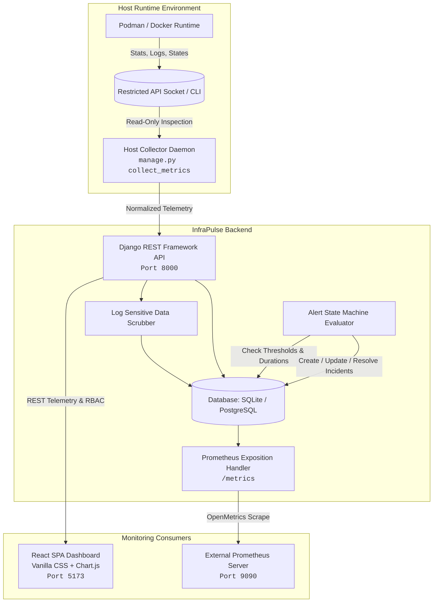
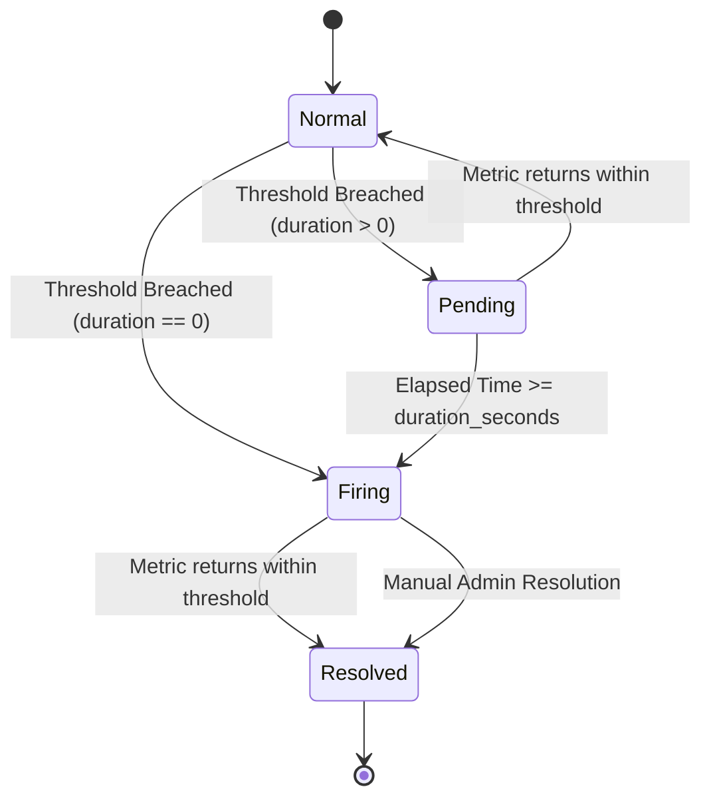

# InfraPulse Architecture Specification

## 1. Executive Architecture Overview

**InfraPulse** is engineered as a decoupled, least-privilege container observability platform. It monitors container health, resource utilization (CPU, memory, network, block I/O), system logs, and evaluates alerts against active telemetry from **Podman** and **Docker** engines.

---

## 2. Decoupled Least-Privilege Collector Model

### Threat Model & Public Surface Protection
- **Vulnerability Avoided**: In traditional setups, mounting the Docker or Podman daemon socket into public-facing web applications allows privilege escalation to host root.
- **InfraPulse Mitigation**: The public web application and React frontend **never touch the runtime socket**.
- A separate host-side collector agent (`CollectorRunner`) runs with minimal read privileges, querying read-only endpoints (`podman ps`, `podman stats`, `podman logs`).
- All incoming log streams pass through an automated credential scrubbing filter (`logs/scrubber.py`) that redacts passwords, Bearer tokens, JWTs, and database URLs before persistence.

---

## 3. Metric Normalization & Pipeline

### Dual Pipeline
1. **Internal Fast Time-Series**:
   - Stored in `MetricSample` records.
   - Provides sliding aggregation windows (5m, 15m, 1h, 6h, 24h) for the React Chart.js UI.
   - Explicitly flags `is_available=False` when containers are stopped or metrics are inaccessible, preventing fake 0-value illusions.
2. **Prometheus Exposition (`/metrics`)**:
   - Conforms strictly to OpenMetrics standard.
   - Exposes `container_cpu_usage_percent`, `container_memory_usage_bytes`, `container_health_status`, `infrapulse_target_up`, and `infrapulse_active_incidents`.

---

## 4. Alert State Machine & Storm Prevention

### Deduplication Logic
- Every incident is assigned a deterministic deduplication key: `dedup_key = f"{rule.id}:{container.id}"`.
- Subsequent evaluations increment `storm_count` and update `last_seen` on the existing incident row rather than creating thousands of duplicate records.
- Prevents notification fatigue and database lock contention.
